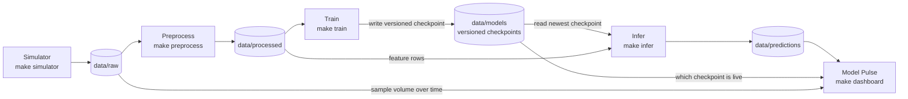

# DashBite — living plan

Food-delivery orders come in; we predict whether an order will be late. Raw fields stay short: `order_id`, `timestamp`, `distance_km`, `prep_minutes`, `order_value`, `was_late`. Plain Python processes, files under `data/`, orchestrated by Make.

Architect owns this base. Later stages append sections; they do not rewrite it.

## Base — Pipeline diagram

Stages are separate processes. They do not import each other. Each `make` target will run `python -m pipeline.<stage>`; the Makefile is the public interface.

Hand-off folders:

- `data/raw` — simulator writes orders
- `data/processed` — preprocess writes feature rows
- `data/models` — train writes versioned checkpoints; infer reads the newest file on disk
- `data/predictions` — infer writes scored orders

Model Pulse (`make dashboard`) only reads artifacts already on disk: predictions, which checkpoint is live, and order timestamps for a sample-volume time series.



The train path ends at a versioned file. The infer path starts from whatever checkpoint is already there. `make run` and `make stop` are the demo switch for the consumers. A stopped trainer does not stop inference.

## Teaching beats

- Folders under `data/` are the API between stages. Simulator, preprocess, train, infer, and Model Pulse meet only as files.
- Train publishes a versioned checkpoint. Infer is a separate consumer of the newest checkpoint on disk. If train is down, scoring continues with the last published model.
- Model Pulse reads outputs that already exist. It does not train, score, or own pipeline logic.
- Every chart is one claim: an active title, human-readable labels, one story. Sample volume is a time series over `timestamp`, not a single count.
- The Makefile is how we orchestrate the demo. Class runs and smoke tests use `make install`, `make test`, `make simulator`, `make preprocess`, `make train`, `make infer`, `make dashboard`, `make run`, `make stop`, and `make clean-data`.
- This file is the one living plan. Architect owns the base. Later stages append; they do not wholesale-overwrite it. Smoke tests in this file use `make …` commands.

## Manual smoke tests

Nothing to run until stages exist. When a stage is appended, its check is a `make` target, not an ad-hoc `python` invocation. If a check has no target yet, add the target first.

## Stage 5 — Inference

### Goal

Score new feature rows from the newest checkpoint already on disk. Inference is a separate process. It keeps scoring after training has stopped, and it waits quietly when no checkpoint exists yet.

### Proposed changes

- [`pipeline/infer.py`](pipeline/infer.py): runnable as `python -m pipeline.infer`. A loop polls about once a second. It chooses the highest `late_vNNN.joblib` under `data/models` and loads it with joblib. It does not import `pipeline.train`.
- If no checkpoint exists, log `waiting for checkpoint` and keep looping. No exception, no empty prediction file.
- For each feature CSV not yet scored, predict with `distance_km` and `prep_minutes`. Write `data/predictions/<same stem>.csv` once. Log `predictions written`.
- Prediction columns, in order: `order_id`, `late_probability`, `predicted_late`, `checkpoint_id`. `predicted_late` is `1` when `late_probability` is at least `0.5`, else `0`. `checkpoint_id` is the checkpoint stem (`late_v001`).
- A `score_new_files` function does one pass. The `__main__` loop is the only part that runs forever. On each pass it re-reads whichever checkpoint is newest, so a stopped trainer is irrelevant as long as the file remains.
- [`Makefile`](Makefile): `make infer` runs `python -m pipeline.infer`.

### Architecture / boundaries

- Infer reads `data/features` and `data/models`, and writes only `data/predictions`. It does not import, call, or wait on training, and it does not start a retrain.
- It does not import the simulator, preprocess, or Model Pulse. Shared path helpers are allowed.
- Missing checkpoint is a normal state, not a crash. Scoring begins on a later pass after a file appears.
- Already written prediction files stay put. A newer checkpoint applies to feature files that have not been scored yet.

### Automated tests

- Unit: among `late_v001` and `late_v003`, the newest is `late_v003`; `predicted_late` flips at `0.5`; `score_new_files` with an empty models directory returns without raising and writes nothing. The infer module does not import `pipeline.train`.
- Regression: prediction header is exactly `order_id,late_probability,predicted_late,checkpoint_id`, and `checkpoint_id` matches the stem of the file that was loaded.
- Integration: a temporary features CSV plus a saved `LogisticRegression` joblib produces a prediction CSV; a second pass does not duplicate it. `make test` is the gate, not the live demo.

### Manual Smoke Test

#### What we're proving

Inference finds a checkpoint, writes predictions, and keeps scoring after training is stopped.

#### Terminal

Terminal 1:

```bash
make simulator
```

Terminal 2:

```bash
make preprocess
```

Terminal 3, before any checkpoint exists:

```bash
make infer
```

Terminal 4, after feature CSVs exist:

```bash
TRAIN_EVERY_N_EVENTS=50 make train
```

After Terminal 3 logs `predictions written`, and again after the next batch once training is stopped:

```bash
ls -lh data/predictions
head -n 5 data/predictions/*.csv
```

#### Watch for

- Terminal 3 first logs `waiting for checkpoint` and does not exit.
- After Terminal 4 logs `checkpoint published`, Terminal 3 logs `predictions written`.
- `head` shows `order_id`, `late_probability`, `predicted_late`, and `checkpoint_id` (for example `late_v001`).
- Ctrl+C Terminal 4. Leave Terminal 3 running. The next feature file still gets a prediction CSV, and `checkpoint_id` is still the artifact left on disk.

#### Stop

Ctrl+C in Terminal 4 first (the proof). Then Ctrl+C in Terminal 3, Terminal 2, and Terminal 1.

## Stage 1 — Foundation

### Goal

Smallest shared foundation before any pipeline stage: environment-backed config, creatable data directories, and a pytest layout. Class still drives it through Make.

### Proposed changes

- [`pipeline/config.py`](pipeline/config.py): `load_config()` returns settings with defaults `TRAIN_EVERY_N_EVENTS=2000` and `BATCH_SIZE=50`, overridden by those environment variables (integers).
- [`pipeline/paths.py`](pipeline/paths.py): helpers that resolve `data/raw`, `data/features`, `data/models`, `data/predictions`, and `data/quality`. `ensure_data_dirs()` creates them and returns the resolved paths so a print is visible.
- [`pipeline/__init__.py`](pipeline/__init__.py): package marker so `python -c` imports work.
- [`pyproject.toml`](pyproject.toml): project metadata, `pytest` dependency, and markers `unit`, `regression`, `integration`.
- [`Makefile`](Makefile): `make install`, `make test` (automated gate only), and `make config`.
- `make config` is the public smoke command. Its recipe is the tiny interpreter check, not a hand-typed command the room has to remember:

```make
config:
	python -c "from pipeline.config import load_config; from pipeline.paths import ensure_data_dirs; print(load_config()); print(ensure_data_dirs())"
```

- Tests under `tests/unit/`, `tests/regression/`, and `tests/integration/`.

### Architecture / boundaries

- Config and paths are a shared library. They are not a pipeline stage and they do not import simulator, preprocess, train, infer, or Model Pulse.
- Later stages hand off through these folders, not through imports of each other. `data/features` is the feature handoff the base diagram called `data/processed`. `data/quality` is extra, for later quality output.
- `data/models` stays the versioned-checkpoint folder infer will read. This stage only creates the directory.
- Defaults stay 2000 and 50 unless the environment overrides them. No containers or extra services.
- The Makefile is the interface. `python -m` / `python -c` stay inside recipes.

### Automated tests

- Unit: `load_config()` uses 2000 and 50 when the env vars are unset, and reads integer overrides when they are set. Path helpers resolve the five directories under a temporary root.
- Regression: a marked test locks the demo defaults at `TRAIN_EVERY_N_EVENTS=2000` and `BATCH_SIZE=50` so a later change cannot quietly retune them.
- Integration: `ensure_data_dirs()` creates all five directories on disk under a temporary root. `make test` is the gate, not the live demo.

### Manual Smoke Test

#### What we're proving

Config loads with the classroom defaults, an environment override wins, and the five data directories are created on disk.

#### Terminal

```bash
make install
make config
TRAIN_EVERY_N_EVENTS=3 BATCH_SIZE=7 make config
```

#### Watch for

- First `make config` prints `TRAIN_EVERY_N_EVENTS` 2000 and `BATCH_SIZE` 50, then the five paths (`data/raw`, `data/features`, `data/models`, `data/predictions`, `data/quality`).
- Those directories exist afterward.
- Second `make config` prints 3 and 7.

#### Stop

Both commands exit on their own. Ctrl+C is not needed.

## Full stack — background demo

### Goal

Keep every stage up together. `make run` starts simulator, preprocess, train, infer, and Model Pulse as background processes. `make stop` ends them. Foreground `make simulator` (and the other stage targets) still block the terminal for a single-stage demo.

### Manual Smoke Test

#### What we're proving

One command runs the whole file handoff, logs stay on disk after the launching shell returns, and Model Pulse keeps reading those files at http://localhost:8501.

#### Terminal

```bash
make install
make run
tail -f .logs/simulator.log .logs/preprocess.log .logs/train.log .logs/infer.log .logs/dashboard.log
```

PIDs are under `.logs/pids/`. The classroom poll cadence is `POLL_INTERVAL_SECONDS=15`.

#### Watch for

- `.logs/simulator.log` contains `new orders arrived`, then new CSVs appear under `data/raw`.
- `.logs/preprocess.log` contains `features written`, then CSVs appear under `data/features`.
- After enough labeled rows (default `TRAIN_EVERY_N_EVENTS=2000`), `.logs/train.log` contains `checkpoint published` and `data/models/` gains `late_v001.joblib`.
- `.logs/infer.log` contains `predictions written`, then CSVs appear under `data/predictions`.
- `.logs/dashboard.log` contains `reading data/features and data/predictions`, and http://localhost:8501 updates: three KPIs, orders over the last hour, `% flagged late` by minute, and ranked field failures.

#### Stop

```bash
make stop
```

## Stage 2 — Order simulator

### Goal

A long-running simulator writes one CSV per batch into `data/raw` until it is stopped.

### Proposed changes

- [`pipeline/simulator.py`](pipeline/simulator.py): `python -m pipeline.simulator`. Each pass writes `BATCH_SIZE` rows (default 50) and logs `new orders arrived`. Sleeps `POLL_INTERVAL_SECONDS`.
- Columns: `order_id`, `timestamp`, `distance_km`, `prep_minutes`, `order_value`, `was_late`. A minority of rows are messy. One new file per batch.
- `write_batch` is the testable piece. The `__main__` loop is the only part that runs forever.
- `make simulator` runs it in the foreground.

### Architecture / boundaries

- Writes only `data/raw`. Does not import preprocess, train, infer, or Model Pulse. May use `load_config` and `ensure_data_dirs`.

### Automated tests

- Unit: six fields; clean `was_late` is `0` or `1`; the batch log contains `new orders arrived`.
- Regression: header is exactly those six columns, and a batch has `BATCH_SIZE` rows.
- Integration: one batch under a temporary raw directory is a readable CSV. `make test` is the gate.

### Manual Smoke Test

#### What we're proving

`make simulator` keeps publishing orders. A second terminal sees new files and a readable header.

#### Terminal

Terminal 1: `make simulator`

Terminal 2, after the first log line:

```bash
ls -lh data/raw
head -n 5 data/raw/*.csv
```

#### Watch for

- Terminal 1 prints `new orders arrived` more than once (about every 15 seconds).
- Terminal 2 shows new CSVs. `head` shows `order_id,timestamp,distance_km,prep_minutes,order_value,was_late`. A messy cell is fine.

#### Stop

Ctrl+C in Terminal 1.

## Stage 3 — Preprocess

### Goal

Read `data/raw`, drop invalid rows, add `hour` and `is_peak`, keep `was_late`, write `data/features`.

### Proposed changes

- [`pipeline/preprocess.py`](pipeline/preprocess.py): `python -m pipeline.preprocess`. Polls `data/raw`, writes each new file once under the same name in `data/features`, logs `features written`.
- Drops a row when the timestamp will not parse, when distance, prep, or order value is blank or not numeric, or when `was_late` is not `0` or `1`.
- `is_peak` is `1` for hours 11–13 and 17–20.
- Output columns: `order_id`, `timestamp`, `distance_km`, `prep_minutes`, `order_value`, `hour`, `is_peak`, `was_late`.
- `make preprocess` is the foreground command.

### Architecture / boundaries

- Reads `data/raw`, writes `data/features`. Does not import the other stages. Raw files stay messy.

### Automated tests

- Unit: hour and peak flags for known timestamps; blank distance and a bad `was_late` are dropped.
- Regression: feature header is exactly the eight columns above.
- Integration: one messy raw CSV produces one feature CSV of valid rows.

### Manual Smoke Test

#### What we're proving

Simulator and preprocess stay separate. Orders move from `data/raw` to `data/features` with `hour`, `is_peak`, and `was_late`.

#### Terminal

Terminal 1: `make simulator`

Terminal 2: `make preprocess`

Terminal 3, after `features written`:

```bash
ls -lh data/raw data/features
head -n 5 data/features/*.csv
```

#### Watch for

- Terminal 1 logs `new orders arrived`. Terminal 2 logs `features written`.
- `head` shows `hour`, `is_peak`, and `was_late`. `is_peak` is `1` only for hours 11–13 and 17–20.

#### Stop

Ctrl+C in Terminal 2, then Terminal 1.

## Stage 4 — Train write path

### Goal

Publish a versioned logistic-regression checkpoint once enough labeled feature rows have arrived. Training does not score orders.

### Proposed changes

- [`pipeline/train.py`](pipeline/train.py): `python -m pipeline.train`. When newly seen labeled rows reach `TRAIN_EVERY_N_EVENTS` (default 2000), fit `LogisticRegression` on `distance_km` and `prep_minutes` only. Log `checkpoint published`.
- Writes `data/models/late_v001.joblib` and `late_v001.metrics.json`, then `late_v002`, without overwriting older files. The sidecar has `version`, `n_rows`, `features`, and both coefficients.
- `maybe_publish` is the testable piece. `make train` is the foreground command.

### Architecture / boundaries

- Reads `data/features`, writes `data/models`. Does not import or wait on inference.

### Automated tests

- Unit: below the threshold, nothing is written; the sidecar lists `distance_km` and `prep_minutes` and both coefficients.
- Regression: names go `late_v001` then `late_v002`, and `late_v001` stays.
- Integration: a tiny threshold on a temporary features directory produces a joblib that loads as `LogisticRegression` plus a readable JSON sidecar.

### Manual Smoke Test

#### What we're proving

Training publishes a checkpoint and a metrics sidecar. Inference is not part of this check.

#### Terminal

Terminal 1: `make simulator`

Terminal 2: `make preprocess`

Terminal 3, after feature CSVs exist: `TRAIN_EVERY_N_EVENTS=50 make train`

Terminal 4, after `checkpoint published`:

```bash
ls -lh data/models
cat data/models/late_v001.metrics.json
```

#### Watch for

- Terminal 3 prints `checkpoint published`.
- `data/models` contains a `late_vNNN.joblib` and matching `.metrics.json`.
- The sidecar shows `features` of `distance_km` and `prep_minutes`. If earlier checkpoints already exist, the new file is the next version, not a rewrite of `late_v001`.

#### Stop

Ctrl+C in Terminal 3, then Terminal 2, then Terminal 1.

## Stage 6 — Model Pulse

### Goal

One sparse page that reads files under `data/` and says whether late prediction looks healthy. It does not run the pipeline.

### Proposed changes

- [`pipeline/pulse.py`](pipeline/pulse.py): sample volume, orders per minute, late-flag percent per minute (join predictions to features on `order_id`), drop rate, and field-failure counts. Window is 60 minutes ending at the latest feature timestamp.
- [`pipeline/dashboard.py`](pipeline/dashboard.py): Streamlit on port 8501. Three KPIs only: Samples, Drop rate, Late flag rate. Hero title is one of "Orders picked up over the last hour", "Orders slowed over the last hour", or "Orders held steady over the last hour". Model chart title is "Flagging more orders late", "Flagging fewer orders late", or "Late flags held steady", with a `% flagged late` axis. Field failures are one horizontal bar chart, largest first, with no table under it.
- Startup log contains `reading data/features and data/predictions`. `make dashboard` runs Streamlit.

### Architecture / boundaries

- Reads `data/raw`, `data/features`, and `data/predictions`. Does not import simulator, preprocess, train, or infer, and does not write their artifacts.

### Automated tests

- Unit: minute buckets, join-by-`order_id` late-flag percent, failure bars sorted by count, and the title phrases above.
- Regression: exactly those three KPI labels, and no revenue or at-risk fields.
- Integration: temporary raw, feature, and prediction CSVs produce a hero series, a late-flag series, and ranked failures.

### Manual Smoke Test

#### What we're proving

`make dashboard` reads pipeline artifacts and shows a volume series, a late-flag series, and ranked field failures.

#### Terminal

Terminal 1: `make simulator`

Terminal 2: `make preprocess`

Terminal 3, after features exist: `TRAIN_EVERY_N_EVENTS=50 make train`

Terminal 4, after a checkpoint exists: `make infer`

Terminal 5, after predictions exist: `make dashboard`

#### Watch for

- Terminal 5 prints Streamlit's local URL (`http://localhost:8501`) and `reading data/features and data/predictions`.
- The page shows three KPIs, an orders-over-the-last-hour chart, a `% flagged late` chart, and horizontal field-failure bars with no table underneath.

#### Stop

Ctrl+C in Terminal 5, then 4, 3, 2, and 1.

## Stage 7 — Containerize

### Goal

Run the same five processes in containers, with data that survives a restart, a health check, and a stop signal Docker actually sends. The earlier plain-Python demo stays available through `make run`.

### Proposed changes

- [`Dockerfile`](Dockerfile): Python 3.11 slim, non-root user, one image for every service.
- [`docker-compose.yml`](docker-compose.yml): `simulator`, `preprocess`, `train`, `infer`, and `dashboard` on port 8501. A named volume is mounted at `/data` via the existing `DASHBITE_DATA_ROOT`. A `test` service runs pytest and is not part of `up`.
- Worker loops handle `SIGTERM` and `SIGINT`, finish the current pass, and exit. Each pass touches a heartbeat file. Compose treats a stale heartbeat as unhealthy. The dashboard health check calls Streamlit's `/_stcore/health`.
- [`Makefile`](Makefile): `make docker-up`, `make docker-down`, `make docker-test`.

### Architecture / boundaries

- Containers do not import each other. They still meet only through files, now on a shared volume.
- `DASHBITE_DATA_ROOT` stays the one path setting. Compose points it at `/data` instead of adding a second path system.
- No queue and no database. The file handoff stays the API.

### Automated tests

- Unit: the stop helper sets its flag on `SIGTERM`. A fresh heartbeat passes and a stale one fails.
- Regression: an unset `DASHBITE_DATA_ROOT` still resolves `data`, and Compose sets `/data` for the workers.
- Integration: `make test` remains the local gate. `make docker-test` is the container gate when Docker is available.

### Manual Smoke Test

#### What we're proving

`make docker-up` builds and starts the stack, the dashboard health URL responds, new order files land on the volume, and `make docker-down` stops the containers.

#### Terminal

```bash
make docker-up
docker compose ps
docker compose logs simulator
curl -fsS http://127.0.0.1:8501/_stcore/health
docker compose exec simulator ls /data/raw
make docker-down
docker compose ps
```

#### Watch for

- All five services are running, and the dashboard health check becomes healthy.
- `curl` prints the Streamlit health body.
- `/data/raw` lists order CSVs.
- After `make docker-down`, `docker compose ps` shows no running DashBite containers. The named volume is kept.

#### Stop

`make docker-down`. Ctrl+C is not required.

## Stage 8 — Train cursor

### Goal

Training polls open only feature files that are not yet on a cursor. When enough new labeled rows arrive, fit on every labeled row seen so far, publish the next checkpoint, and record the new filenames.

### Proposed changes

- [`pipeline/train.py`](pipeline/train.py): `data/models/train_cursor.json` lists consumed feature filenames. A poll that does not publish reads only files absent from that list. `TRAIN_EVERY_N_EVENTS` counts those new labeled rows. Unpublished files stay off the cursor.
- On publish, read the cursor files and the new files and fit `LogisticRegression` on all of their labeled rows. Both classes must be present in that full set. A new batch that is all on-time still publishes when older rows contain both labels.
- The sidecar keeps `n_rows` as the count of rows newly included. Add `n_rows_fit` for the full fit size. Features stay `distance_km` and `prep_minutes`.
- If `train_cursor.json` is missing and sidecars already exist, walk feature files in filename order and mark a prefix consumed only when the labeled-row total equals `sum(n_rows)` on a file boundary. Write the cursor then. If the total does not land on a boundary, do not guess: keep the current row-count slice for that call.

### Architecture / boundaries

- The cursor is a file under `data/models`. Train still does not import preprocess, infer, or Model Pulse.
- Feature CSVs stay the training data. The full reread happens only when a checkpoint is published.
- Infer still scores only unscored feature files. Older prediction CSVs stay put.
- `n_rows` remains the number of newly included rows, so a sum across sidecars is still a count of distinct rows. `n_rows_fit` is the size of that publish's fit.

### Automated tests

- Unit: below the threshold, no checkpoint and no cursor. A later call with too few new rows does not publish. A later call with enough new rows sets `n_rows` to the new count and `n_rows_fit` to old plus new. A missing cursor rebuilds from sidecar `n_rows` when that count lands on a file boundary, and does not write a cursor when the count splits a file.
- Regression: sidecar features stay `distance_km` and `prep_minutes`, with both coefficients. Versions still go `late_v001` then the next free number, without rewriting the older file.
- Integration: the first publish on a new directory loads as `LogisticRegression`, and `n_rows_fit` equals `n_rows` when every current row is new. `make test` is the gate.

### Manual Smoke Test

#### What we're proving

Training writes `train_cursor.json` from the checkpoints already on disk, then the next checkpoint is fit on those older rows plus the new ones.

#### Terminal

Terminal 1:

```bash
make simulator
```

Terminal 2:

```bash
make preprocess
```

Terminal 3, after feature CSVs exist:

```bash
TRAIN_EVERY_N_EVENTS=50 make train
```

After Terminal 3 logs `checkpoint published` for a version past the ones already in `data/models`:

```bash
ls data/models/train_cursor.json
cat data/models/train_cursor.json
cat data/models/late_v*.metrics.json
```

#### Watch for

- `train_cursor.json` lists feature CSV filenames.
- The new sidecar has `n_rows` for the rows just included and `n_rows_fit` larger than `n_rows` once older rows were already consumed.
- Earlier `late_vNNN` files are still present.
- `features` is still `distance_km` and `prep_minutes`.

#### Stop

Ctrl+C in Terminal 3, then Terminal 2, then Terminal 1.

## Stage 9 — Three regression locks

### Goal

Lock three rules the suite does not cover yet. The running pipeline does not change.

### Proposed changes

- [`tests/unit/test_runtime.py`](tests/unit/test_runtime.py): `python -m pipeline.health` returns normally when the simulator heartbeat is fresh, and exits 1 when that file is missing or older than 45 seconds.
- [`tests/unit/test_preprocess.py`](tests/unit/test_preprocess.py): hours 10, 14, 16, and 21 are off-peak. Hours 11, 13, 17, and 20 are peak.
- [`tests/unit/test_train.py`](tests/unit/test_train.py): a batch of only on-time rows, past `TRAIN_EVERY_N_EVENTS`, does not publish a checkpoint and does not write `train_cursor.json`.

### Architecture / boundaries

- These tests call the existing health command, `clean_row`, and `maybe_publish`. They do not start containers, poll loops, or Model Pulse.
- Peak hours stay `{11, 12, 13, 17, 18, 19, 20}`. A single label still blocks the first publish.

### Automated tests

- Unit: a fresh heartbeat exits 0; a missing heartbeat and a stale one exit 1. The peak-hour edges above stay on or off as listed. Only on-time rows above the threshold leave no `late_v*.joblib` and no cursor.
- `make test` is the gate. The suite is 43 tests.

### Manual Smoke Test

#### What we're proving

The three new checks are part of the suite, and the demo commands are unchanged.

#### Terminal

```bash
make test
```

#### Watch for

- Pytest reports 43 passed.

#### Stop

The command exits on its own. Ctrl+C is not needed.
